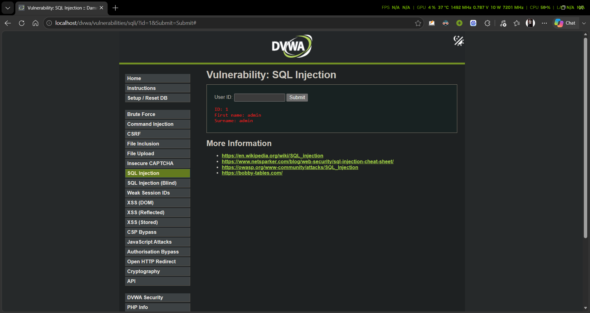
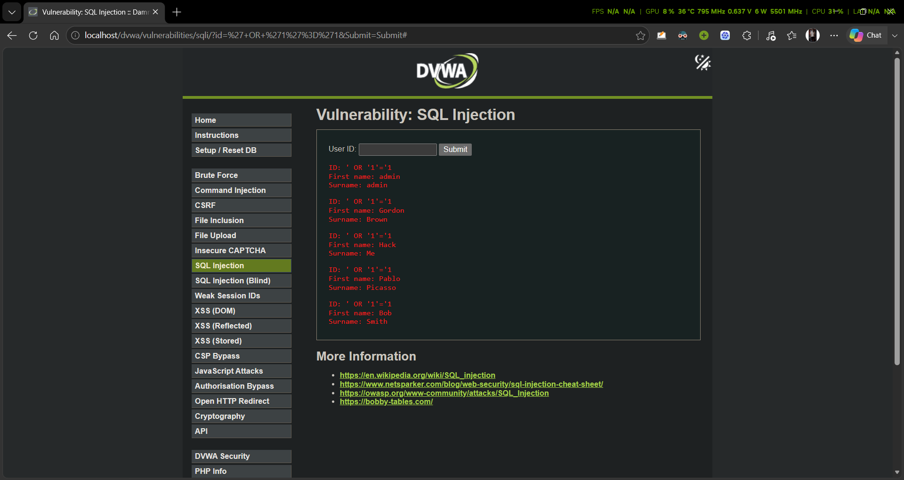
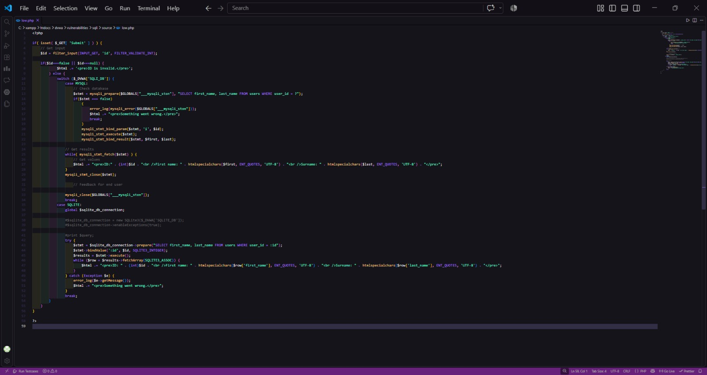
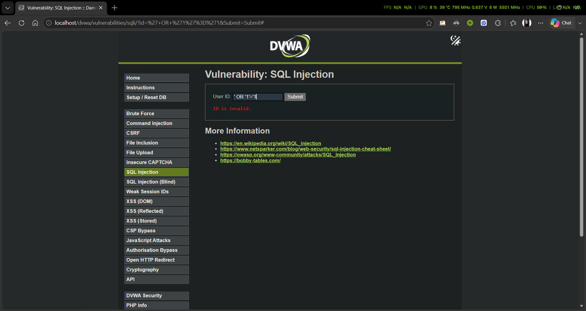

SQL Injection Assessment & Remediation Report

Date: November 12, 2026

Author: [Your Name]

Target Environment: DVWA (Localhost) - Security Level: Low

Vulnerability Type: SQL Injection (SQLi)

1. Executive Summary

This report documents the identification, exploitation, and remediation of a SQL Injection vulnerability within a deliberately vulnerable web application (DVWA). The assessment demonstrates how improper handling of user input can lead to unauthorized database access and data leakage, followed by a secure code implementation to effectively mitigate the risk.

2. Vulnerability Assessment (Detection & Exploitation)

2.1 Baseline Behavior

Under normal operating conditions, the application expects an integer value for the User ID parameter. When a valid ID (e.g., 1) is submitted, the application queries the database and returns the corresponding user's details (First Name and Surname).

Proof of Baseline:

2.2 Exploitation (Proof of Concept)

The vulnerability exists because the application concatenates user-supplied input directly into the SQL query without proper sanitization or parameterization.

By injecting the payload ' OR '1'='1, the backend SQL query is manipulated to always evaluate to TRUE. This bypasses the intended WHERE clause logic, causing the database to return all records from the users table instead of a single record.

Payload Used: ' OR '1'='1

Proof of Exploitation (Data Leakage):

3. Remediation

3.1 Vulnerability Root Cause

The original source code was vulnerable because it directly executed the following query format:
SELECT first_name, last_name FROM users WHERE user_id = '$id';
This allowed arbitrary SQL commands to be injected via the $id variable.

3.2 Secure Code Implementation

To permanently resolve this vulnerability, two main security controls were implemented:

Input Validation: The filter_input() function was used to ensure the provided ID is strictly an integer (FILTER_VALIDATE_INT).

Parameterized Queries (Prepared Statements): The mysqli_prepare function was implemented to separate the SQL logic from the user-supplied data. This ensures that the database treats the input strictly as data (a parameter), nullifying any malicious SQL syntax.

Remediated Source Code:

<?php
if( isset( $_GET[ 'Submit' ] ) ) {
    // 1. Input Validation
    $id = filter_input(INPUT_GET, 'id', FILTER_VALIDATE_INT);

    if($id===false || $id===null) {
        $html .= '<pre>ID is invalid.</pre>';
    } else {
        switch ($_DVWA['SQLI_DB']) {
            case MYSQL:
                // 2. Prepared Statement Implementation
                $stmt = mysqli_prepare($GLOBALS["___mysqli_ston"], "SELECT first_name, last_name FROM users WHERE user_id = ?");
                
                if($stmt === false) {
                    error_log(mysqli_error($GLOBALS["___mysqli_ston"]));
                    $html .= "<pre>Something went wrong.</pre>";
                    break;
                }
                
                // Bind parameters and execute
                mysqli_stmt_bind_param($stmt, 'i', $id);
                mysqli_stmt_execute($stmt);
                mysqli_stmt_bind_result($stmt, $first, $last);

                // Get results
                while( mysqli_stmt_fetch($stmt) ) {
                    $html .= "<pre>ID:" . (int)$id . " First name: " . htmlspecialchars($first, ENT_QUOTES, 'UTF-8') . " Surname: " . htmlspecialchars($last, ENT_QUOTES, 'UTF-8') . "</pre>";
                }
                mysqli_stmt_close($stmt);
                mysqli_close($GLOBALS["___mysqli_ston"]);
                break;
                
            // ... [SQLITE implementation continues] ...
        } 
    }
}
?>

Proof of Code Modification:

4. Verification & Retesting

Following the code modifications, the exact same malicious payload (' OR '1'='1) was resubmitted to the application.

Due to the implemented input validation (FILTER_VALIDATE_INT), the application immediately recognized the injected string as an invalid integer and rejected the request with the message "ID is invalid." The database was protected from unauthorized queries.

Proof of Remediation (Failed Exploit):

5. Conclusion

The SQL Injection vulnerability was successfully identified, exploited in a controlled environment, and fully mitigated using industry-standard secure coding practices (Prepared Statements and Input Validation). The application is now resilient against SQL injection attacks on this endpoint.
